<div align="center">

# 🧠 Deep Learning Practical Exam — Set C
### Four Neural-Network Architectures, One Notebook — ANN · OpenCV · CNN · RNN

[](https://www.python.org/)
[](https://www.tensorflow.org/)
[](https://keras.io/)
[](https://opencv.org/)
[](https://scikit-learn.org/)
[]()

*Five mini-projects were scoped, four were built end to end: a tabular ANN, an OpenCV computer-vision
pipeline, a CNN vs. ANN digit-recognition showdown, and a GRU time-series forecaster — each trained,
evaluated, and saved independently.*

</div>

---

## 🧭 Table of Contents

- [📌 Overview](#-overview)
- [🗺️ Project Roadmap](#️-project-roadmap)
- [🍷 Step 1 — ANN: Wine Classification](#-step-1--ann-wine-classification)
- [👁️ Step 2 — OpenCV: Colour, Morphology & Face Detection](#️-step-2--opencv-colour-morphology--face-detection)
- [🔢 Step 3 — CNN vs. ANN: MNIST Digit Recognition](#-step-3--cnn-vs-ann-mnist-digit-recognition)
- [🌡️ Step 4 — RNN: Melbourne Temperature Forecasting](#️-step-4--rnn-melbourne-temperature-forecasting)
- [📊 Results Leaderboard](#-results-leaderboard)
- [⚠️ Scope Note — Step 5](#️-scope-note--step-5)
- [⚙️ Tech Stack](#️-tech-stack)
- [🚀 Getting Started](#-getting-started)
- [📁 Repository Structure](#-repository-structure)
- [🎥 Video Walkthrough](#-video-walkthrough)
- [🙋 Author](#-author)

---

## 📌 Overview

This exam packs **four self-contained deep-learning mini-projects** into a single notebook, each
covering a different architecture family and a different kind of data — tabular, image, image-grid,
and sequence:

> `ANN (tabular)` → `OpenCV (classical CV)` → `CNN vs. ANN (image classification)` → `RNN/GRU (time series)`

Every project follows the same discipline: load data, justify the preprocessing, build the model,
train it, evaluate it against a baseline, and save the artifact — no step is skipped, and no metric
is reported without the code that produced it.

---

## 🗺️ Project Roadmap

| # | Module | Architecture | Dataset | Task |
|---|---|---|---|---|
| 1️⃣ | **ANN** | Dense(16) → Dense(8) → Dense(3, softmax) | Wine Recognition (sklearn) | Multi-class tabular classification |
| 2️⃣ | **OpenCV** | Haar Cascade + classical CV ops | 5 images (4 scikit-image + 1 custom) | Colour space, morphology, edges, face detection |
| 3️⃣ | **CNN vs. ANN** | Conv2D ×2 → Dense vs. Flatten → Dense ×2 | MNIST (20K train / 4K test) | Digit classification head-to-head |
| 4️⃣ | **RNN** | GRU(32) → Dense(1), + bonus LSTM(32) | Daily Min. Temperatures, Melbourne | 30-day lookback forecasting |

---

## 🍷 Step 1 — ANN: Wine Classification

**Dataset:** Wine Recognition — 178 wines, 13 chemical features, 3 cultivars, loaded directly from
`sklearn.datasets.load_wine(as_frame=True)`. No missing values.

**Why scaling matters:** `proline` ranges roughly 278–1680 while `hue` ranges roughly 0.48–1.71 — a
13× difference in scale. Left unscaled, gradient descent would let `proline` dominate the weighted
sum and gradients, drowning out `hue` almost entirely. `StandardScaler` (fit on the train split only)
puts every feature on equal footing.

**Split:** 80/20 stratified (`random_state=42`) → **142 train / 36 test**.

**Architecture:** `Input(13) → Dense(16, relu) → Dense(8, relu) → Dense(3, softmax)`, Adam optimizer,
categorical cross-entropy, 60 epochs, batch size 8.

> **Hand-verified parameter count:** (13×16+16) + (16×8+8) + (8×3+3) = 224 + 136 + 27 = **387**,
> matching `model.summary()` exactly.

<table>
<tr>
<td width="33%">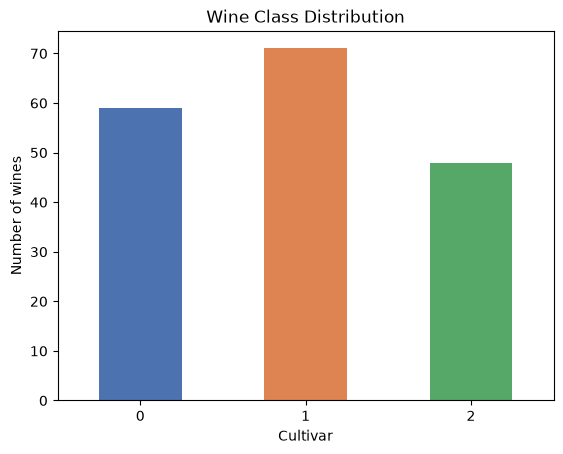<br><sub>Class distribution</sub></td>
<td width="33%">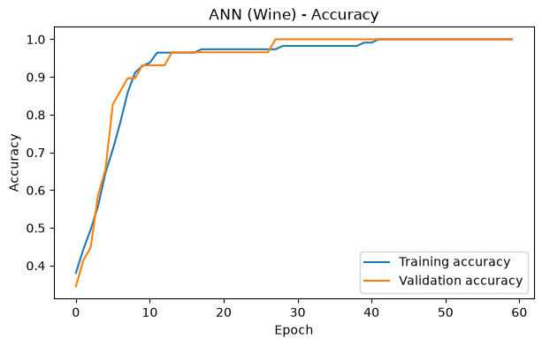<br><sub>Training vs. validation accuracy</sub></td>
<td width="33%">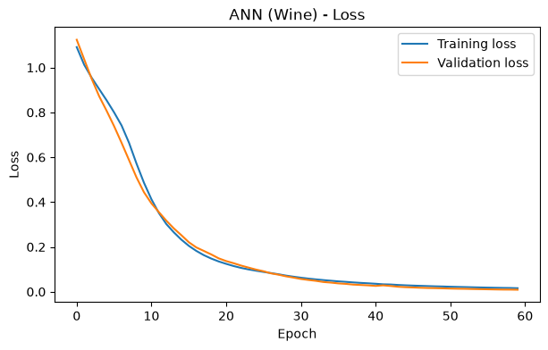<br><sub>Training vs. validation loss</sub></td>
</tr>
</table>

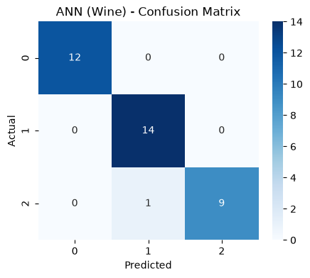

| Metric | Value |
|---|:---:|
| Final train accuracy | 1.000 |
| Final val accuracy | 1.000 |
| **Test accuracy** | **0.9722** |
| Macro F1 | 0.97 |

Saved to `models/ann_wine_model.h5`.

---

## 👁️ Step 2 — OpenCV: Colour, Morphology & Face Detection

**Images:** `astronaut`, `coffee`, `chelsea`, `rocket` (scikit-image) + `colorwheel` (a bright,
custom-choice image) — loaded as RGB and converted to BGR to behave like `cv2.imread()`.

**Pipeline applied to every image:** resize → HSV conversion → blue-range colour mask
(`cv2.inRange`) → morphological erode/dilate cleanup → Sobel edge detection (X + Y combined) →
Haar-cascade frontal-face detection.

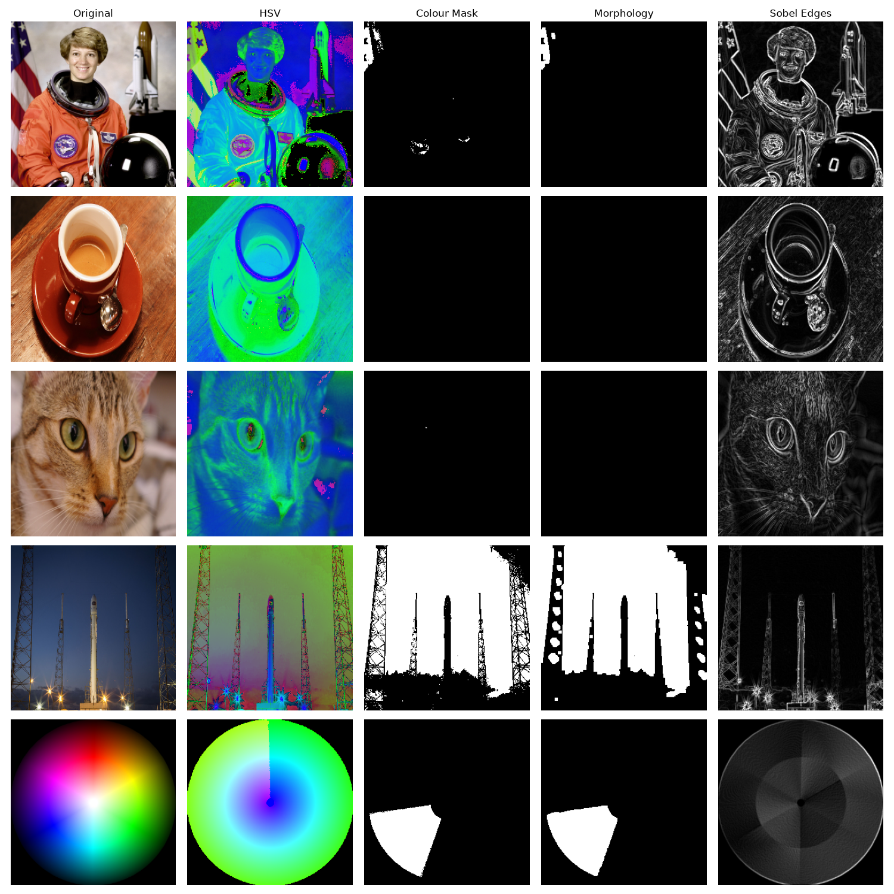

*Original → HSV → Colour Mask → Morphology → Sobel Edges, for all 5 images.*

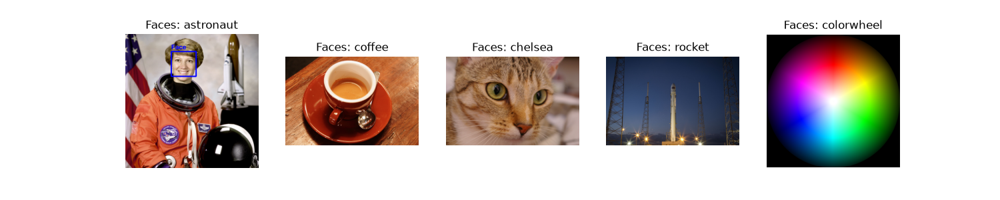

*Haar-cascade face detection across all 5 images.*

| Image | Shape | Mean Brightness | Faces Found |
|---|---|:---:|:---:|
| astronaut | 512×512×3 | 114.60 | **1** |
| coffee | 400×600×3 | 98.62 | 0 |
| chelsea | 300×451×3 | 115.31 | 0 |
| rocket | 427×640×3 | 65.28 | 0 |
| colorwheel | 370×371×3 | 76.33 | 0 |

A `minNeighbors` sweep (2 / 5 / 8) on the astronaut image returned 1 face at every setting —
the detection was stable across sensitivity levels, not a borderline call.

<details>
<summary>🔍 Full per-image stage breakdown (click to expand)</summary>
<br>

<table>
<tr><td align="center"><b>astronaut</b></td></tr>
<tr>
<td>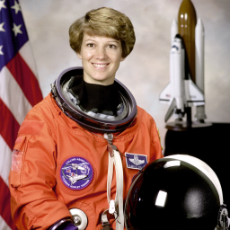</td>
<td>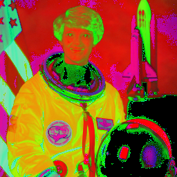</td>
<td>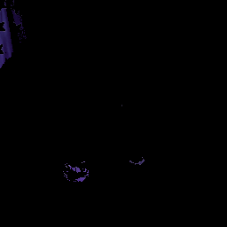</td>
<td>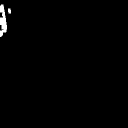</td>
<td>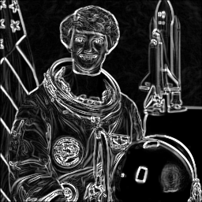</td>
<td>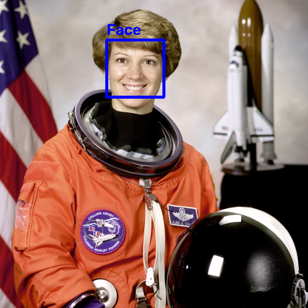</td>
</tr>
</table>

*(Same 6-stage sequence — original, HSV, colour mask, morphology, Sobel, faces — is saved per image
for `coffee`, `chelsea`, `rocket`, and `colorwheel` in `outputs/`.)*

</details>

---

## 🔢 Step 3 — CNN vs. ANN: MNIST Digit Recognition

**Dataset:** MNIST, subsampled to 20,000 train / 4,000 test images, normalized to [0, 1].

| Model | Architecture | Parameters | Test Accuracy |
|---|---|:---:|:---:|
| **CNN** | Conv2D(16) → Pool → Conv2D(32) → Pool → Dense(64) → Dense(10) | **56,714** | **0.9793** |
| ANN | Flatten → Dense(128) → Dense(64) → Dense(10) | 109,386 | 0.9575 |

The CNN wins on accuracy **with roughly half the parameters** — the clearest demonstration in this
exam of why convolution (local, weight-shared filters) beats a fully-connected network on image data.

<table>
<tr>
<td width="50%">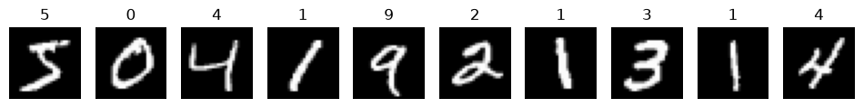<br><sub>Sample training digits</sub></td>
<td width="50%">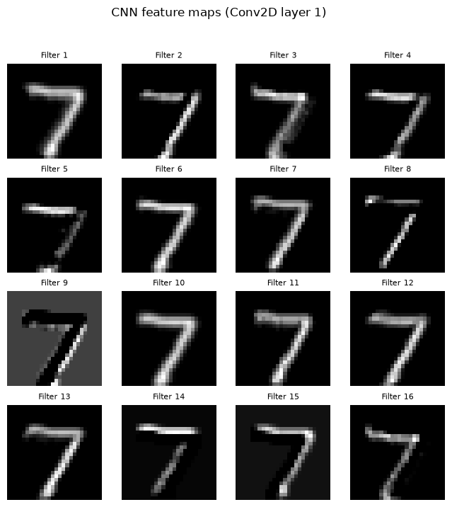<br><sub>CNN first-layer feature maps (16 filters)</sub></td>
</tr>
<tr>
<td width="50%">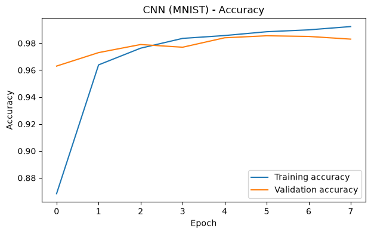<br><sub>CNN training vs. validation accuracy</sub></td>
<td width="50%">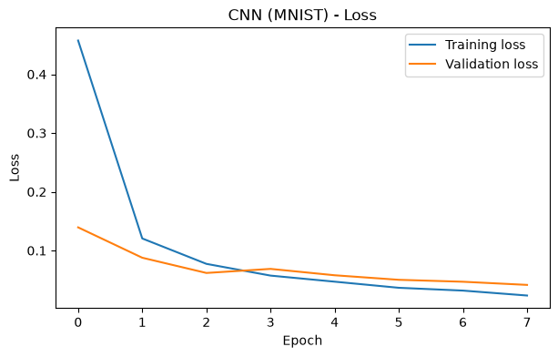<br><sub>CNN training vs. validation loss</sub></td>
</tr>
</table>

<table>
<tr>
<td width="50%">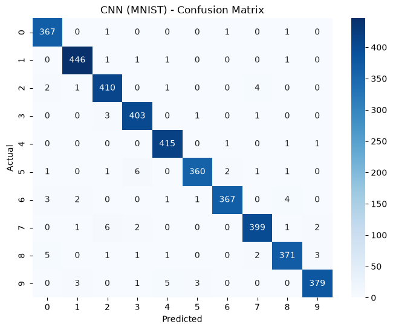<br><sub>Confusion matrix</sub></td>
<td width="50%">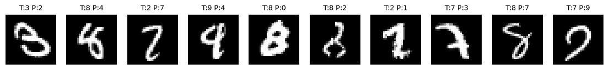<br><sub>83 misclassified digits (sample of 10)</sub></td>
</tr>
</table>

`EarlyStopping(patience=2, restore_best_weights=True)` was applied to the CNN only, for direct
comparison against an ANN trained for the full 8 epochs. Out of 4,000 test digits, **83 were
misclassified** — a 2.1% error rate.

Saved to `models/cnn_mnist_model.h5`.

---

## 🌡️ Step 4 — RNN: Melbourne Temperature Forecasting

**Dataset:** Daily Minimum Temperatures, Melbourne, 1981–1990 (3,650 days), loaded directly from
[jbrownlee/Datasets](https://raw.githubusercontent.com/jbrownlee/Datasets/master/daily-min-temperatures.csv).
No missing values after a numeric-coercion safety check.

**Setup:** chronological 80/20 split (no shuffling — this is a time series), `MinMaxScaler` fit on
the train portion only, 30-day lookback window → **2,890 training sequences / 700 test sequences**.

**Architecture:** `GRU(32, tanh) → Dense(1)`, Adam optimizer, MSE loss, 15 epochs, batch size 32.
A **naive baseline** ("tomorrow = today's temperature") was computed for comparison — the bar any
real model needs to clear.

<table>
<tr>
<td width="50%">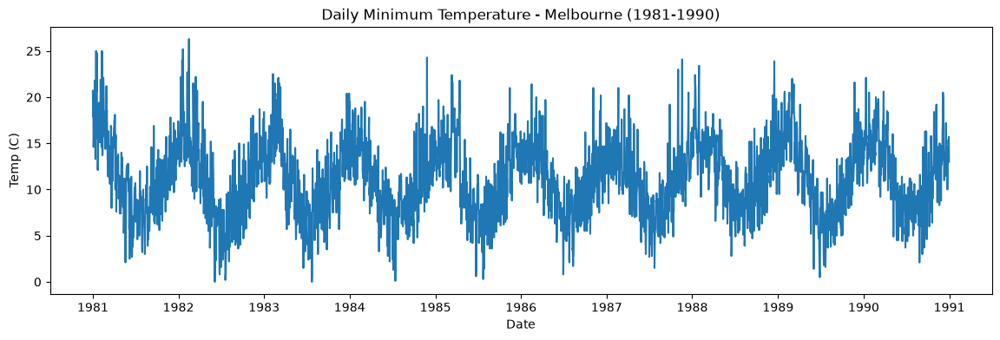<br><sub>Full 1981–1990 series</sub></td>
<td width="50%">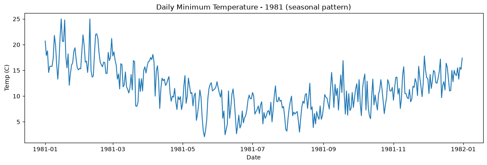<br><sub>1981 alone — seasonal pattern</sub></td>
</tr>
</table>

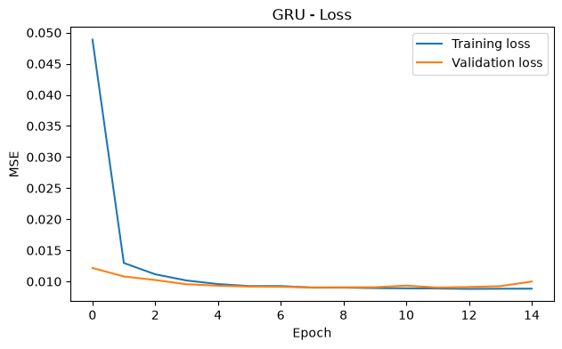

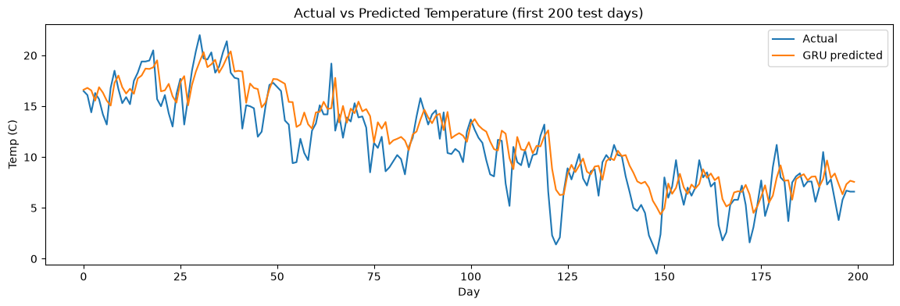

*Actual vs. GRU-predicted temperature, first 200 test days.*

| Model | RMSE (°C) | MAE (°C) |
|---|:---:|:---:|
| Naive baseline | 2.486 | 1.951 |
| **GRU** | **2.356** | **1.859** |
| Bonus — LSTM(32) | 2.335 | — |

The GRU beat the naive baseline by **0.13°C RMSE** — a real but modest edge, which is typical for
daily temperature, a series with strong short-term autocorrelation that a "yesterday ≈ today" rule
already captures well. The bonus LSTM run edged out the GRU slightly (2.335 vs. 2.356), suggesting
the gate structure difference matters more than architecture choice alone would predict on a series
this short.

Saved to `models/rnn_temperature_model.h5`.

---

## 📊 Results Leaderboard

| Step | Topic | Task Type | Dataset | Key Metric | Result | Time Taken |
|---|---|---|---|---|:---:|:---:|
| 1 | ANN | Multi-class Classification | Wine (178 rows, 13 features) | Accuracy | **0.9722** | 0.6 min |
| 2 | OpenCV | Preprocessing & Detection | 5 images | Faces detected | 1 face | 0.9 min |
| 3 | CNN | Classification | MNIST (20K / 4K) | Accuracy | **0.9793** | 15.4 min |
| 4 | RNN (GRU) | Time-series Regression | Melbourne temps (3,650 days) | RMSE (°C) | **2.356** | 1.5 min |

---

## ⚠️ Scope Note — Step 5

The notebook's header scopes a fifth module — **Transformers** (fill-mask, question answering, and
text generation with Hugging Face, across 5 India-related paragraphs) — but no cells implementing it
exist in the submitted notebook, and it's absent from the final results table above. This README
reports exactly what was built and run: Steps 1–4 plus the comparison, with Step 5 left as scoped
but not completed in this submission.

---

## ⚙️ Tech Stack

| Category | Tools |
|---|---|
| 🧠 Deep Learning | TensorFlow / Keras (Dense, Conv2D, GRU, LSTM) |
| 👁️ Computer Vision | OpenCV, scikit-image, Haar Cascade |
| 🤖 ML Utilities | scikit-learn (`StandardScaler`, `MinMaxScaler`, `train_test_split`, metrics) |
| 🐼 Data | pandas, NumPy |
| 📈 Visualization | Matplotlib, Seaborn |
| 📓 Environment | Jupyter Notebook |

---

## 🚀 Getting Started

```bash
# 1. Clone the repo
git clone https://github.com/krish-desai-123/Deep-Learning-.git
cd "Deep-Learning-/Exam"

# 2. Create a virtual environment (recommended)
python -m venv venv
source venv/bin/activate      # Windows: venv\Scripts\activate

# 3. Install dependencies
pip install tensorflow scikit-learn opencv-python scikit-image pandas numpy matplotlib seaborn

# 4. Launch the notebook
jupyter notebook Exam_SetC.ipynb
```

No manual dataset downloads needed — Wine and MNIST load from `sklearn`/`keras` directly, and the
temperature CSV streams from its public GitHub URL. The Haar cascade XML ships in this folder.

```python
# Reload any saved model
from tensorflow import keras
model = keras.models.load_model("models/ann_wine_model.h5")   # or cnn_mnist_model.h5 / rnn_temperature_model.h5
```

---

## 📁 Repository Structure

```
Exam/
├── Exam_SetC.ipynb                  # Full notebook — Steps 1–4 + comparison
├── README.md                        # You are here 👋
├── haarcascade_frontalface_default.xml
├── models/
│   ├── ann_wine_model.h5
│   ├── cnn_mnist_model.h5
│   └── rnn_temperature_model.h5
└── outputs/
    ├── opencv_5x5_grid.png
    ├── opencv_face_detections.png
    ├── astronaut_1_original.png ... astronaut_6_faces.png
    ├── coffee_1_original.png ... coffee_6_faces.png
    ├── chelsea_1_original.png ... chelsea_6_faces.png
    ├── rocket_1_original.png ... rocket_6_faces.png
    ├── colorwheel_1_original.png ... colorwheel_6_faces.png
    └── plots/
        ├── wine_class_distribution.png
        ├── ann_wine_accuracy.png / ann_wine_loss.png / ann_wine_confusion_matrix.png
        ├── mnist_sample_digits.png / cnn_feature_maps.png
        ├── cnn_mnist_accuracy.png / cnn_mnist_loss.png
        ├── cnn_mnist_confusion_matrix.png / cnn_mnist_wrong_predictions.png
        ├── temp_full_series.png / temp_1981_seasonal.png
        └── gru_loss_curve.png / gru_actual_vs_predicted.png
```

---

## 🎥 Video Walkthrough

> 🎬 **Video placeholder** — walkthrough link to be added here.

Will cover: why scaling matters for the Wine dataset, the Haar-cascade face-detection results
across all 5 images, why the CNN beats the ANN on MNIST with fewer parameters, and how the GRU
compares to both the naive baseline and the bonus LSTM run.

---

## 🙋 Author

**Krish Desai** — [@krish-desai-123](https://github.com/krish-desai-123)

<div align="center">

*⭐ If this project helped you understand ANN, CNN, RNN, and OpenCV fundamentals, consider starring the repo!*

</div>
