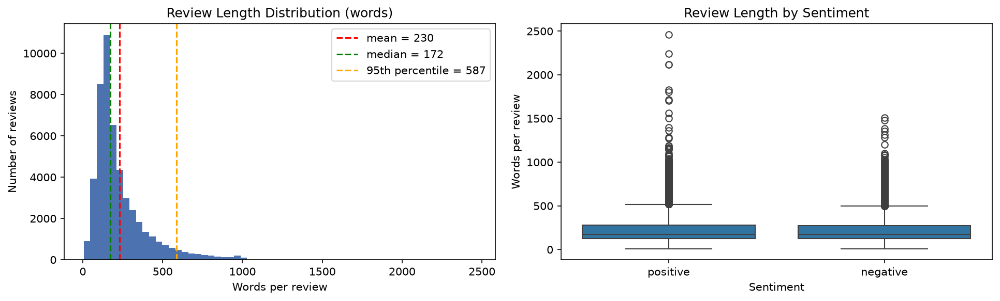
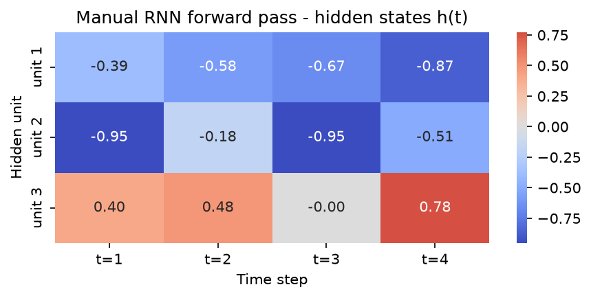
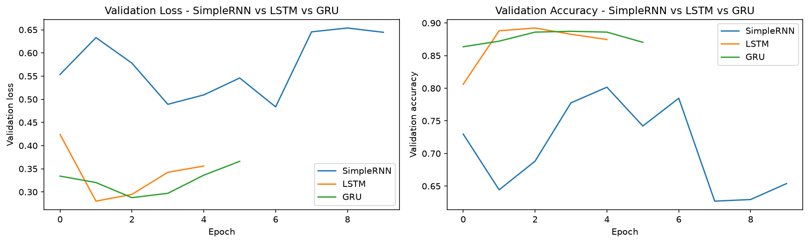
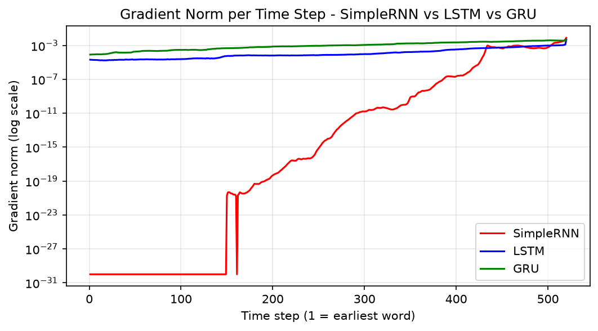
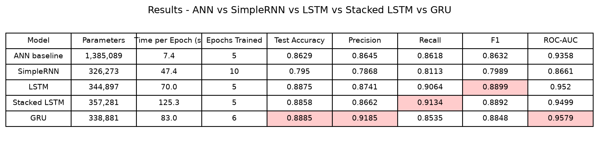
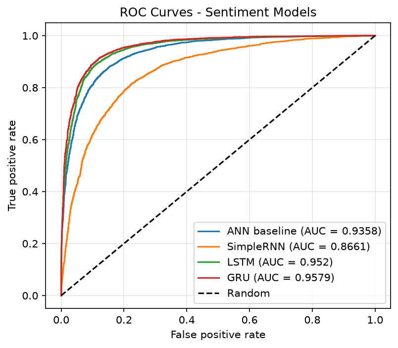
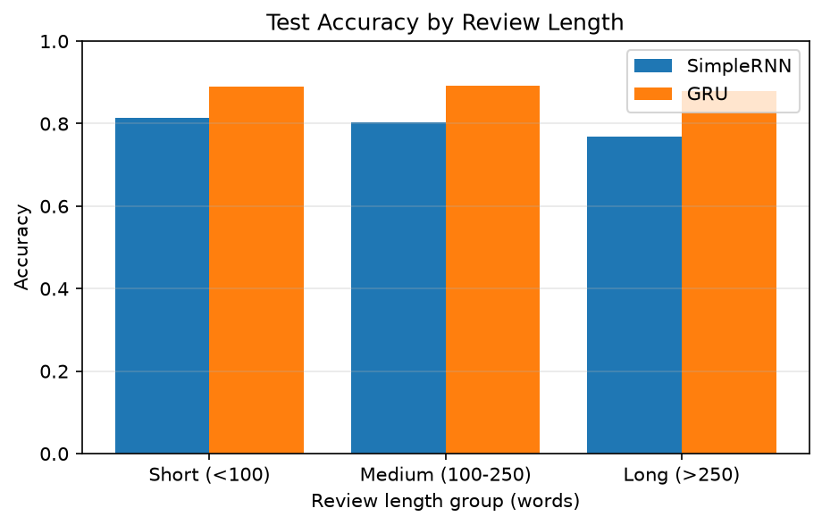
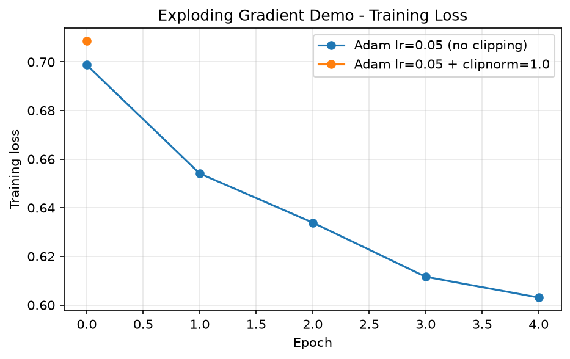
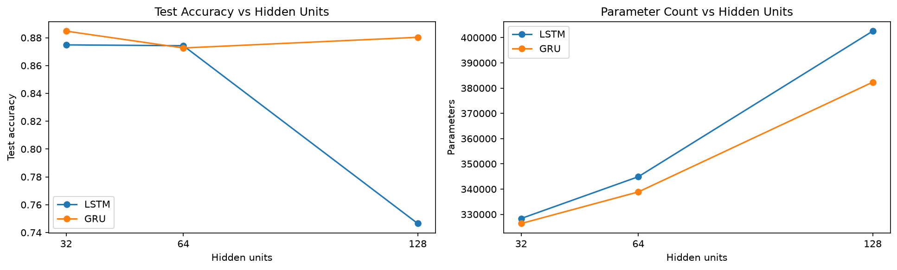

<div align="center">


</div>

---

## 📌 Overview
A deep-learning study of **movie-review sentiment analysis** (positive / negative) that compares an order-blind **ANN baseline** with three recurrent cells — **SimpleRNN, LSTM and GRU** — and *measures* why plain RNNs forget early words (vanishing gradients) and how gates fix it. The notebook builds an RNN cell by hand in NumPy, verifies it against Keras, tracks gradient norms per time step with `tf.GradientTape`, and ends with a model comparison, error analysis, an inference function and a recommendation.

> Scope: SimpleRNN, LSTM and GRU only — no attention, no Transformers, no pretrained embeddings.

## 📂 Dataset
| Field | Detail |
|---|---|
| Name | IMDB Dataset of 50K Movie Reviews |
| Source | [Kaggle – IMDB Dataset of 50K Movie Reviews](https://www.kaggle.com/datasets/lakshmi25npathi/imdb-dataset-of-50k-movie-reviews) |
| File | `IMDB Dataset.csv` (`review`, `sentiment`) |
| Size | 50,000 reviews — 25,000 positive / 25,000 negative |
| Issues handled | HTML tags (`<br />`), mixed case, punctuation, exact duplicate reviews |

**Citation:** Maas, A. L., Daly, R. E., Pham, P. T., Huang, D., Ng, A. Y., & Potts, C. (2011). *Learning Word Vectors for Sentiment Analysis.* Proceedings of the 49th Annual Meeting of the Association for Computational Linguistics (ACL 2011), pp. 142–150. Stanford AI Lab, Large Movie Review Dataset.

> The CSV is not stored in this repository — download it from the Kaggle link and place it next to the notebook.

## 🗂️ Repository Structure
```
Sentiment Analysis/
├── DL_PR5.ipynb          # full notebook (all 7 tasks)
├── DL_PR5.html           # exported, fully executed notebook
├── plots/                # figures produced by the notebook
├── requirements.txt
└── README.md
```

## ⚙️ How to Run
```bash
git clone https://github.com/krish-desai-123/Deep-Learning-.git
cd "Deep-Learning-/Sentiment Analysis"
pip install -r requirements.txt
# download "IMDB Dataset.csv" from the Kaggle link above into this folder
jupyter notebook DL_PR5.ipynb        # Kernel -> Restart & Run All
```
All figures are written to `plots/` automatically while the notebook runs.

## 🧹 Preprocessing Summary
<details>
<summary><b>Click to expand the pipeline</b></summary>

1. **Duplicates removed first** — so the same review can never be in both the training and the test set (no data leakage).
2. **`clean_text()`** — lowercase, strip HTML tags, keep only letters and apostrophes, collapse spaces. Apostrophes are kept (*don't*, *isn't* carry negation) and **stop-words are not removed** (*not*, *no* flip the sentiment and order matters).
3. **Stratified 80/20 split** (`random_state=42`) done **before** tokenising.
4. **`Tokenizer(num_words=10000, oov_token='<OOV>')`** fitted on the training texts only.
5. **`pad_sequences(padding='pre', truncating='pre')`** to `MAXLEN` (about the 90th–95th percentile of review length), so the RNN's final hidden state is built from real words, not zeros.


*Review lengths are strongly right-skewed (mean above median); the dashed lines mark the mean, median and 95th percentile. The boxplot shows both classes have similar lengths.*
</details>

## 🧠 Models
<details>
<summary><b>🔁 SimpleRNN</b></summary>

A SimpleRNN reads a review one word at a time and carries a hidden state `h(t) = tanh(Wxh·x(t) + Whh·h(t-1) + b)`, re-using the **same weights at every time step**. Its parameter count (`units × (embedding_dim + units + 1)` = 6,208 for 64 units) does **not** depend on the sequence length, unlike the ANN baseline. The notebook implements the cell by hand in NumPy, plots the hidden states as a heatmap and verifies the result against Keras with `np.allclose`. In practice a SimpleRNN has a short effective memory (~10–20 steps) because of vanishing gradients.


*Hidden states h(t) of a hand-written RNN cell (3 hidden units, 4 time steps).*
</details>

<details>
<summary><b>🧠 LSTM</b></summary>

An LSTM adds a **cell state** (a conveyor belt for information) and three gates — forget, input and output — that decide what to forget, what to write and what to reveal. Because the cell state is updated by addition and a forget-gate multiplication, the gradient along it is not squeezed by `Whh` and tanh′ at every step, so it survives across many time steps. It has four weight sets: `4 × units × (embedding_dim + units + 1)` = 24,832 parameters for 64 units. A manual single-step LSTM in NumPy shows how `C(t)` is preserved when the forget gate is near 1 and the input gate near 0; a stacked LSTM (`return_sequences=True` on the first layer) is also evaluated.
</details>

<details>
<summary><b>⚡ GRU</b></summary>

A GRU uses two gates — **update** and **reset** — and no separate cell state: the update gate decides how much of the old state to keep versus replace, and the reset gate decides how much of the past to use when proposing the new candidate. It merges the LSTM's forget and input gates, so it needs three weight sets (`3 × (units × embedding_dim + units × units + 2 × units)` = 18,816 parameters for 64 units, with the Keras default `reset_after=True`) — about three quarters of the LSTM — and trains faster.


*Validation loss and accuracy of SimpleRNN, LSTM and GRU under an identical training setup.*
</details>

## 🔬 Gradient Flow Analysis
The gradient of the loss with respect to the hidden state at **every time step** is measured with `tf.GradientTape` by unrolling each trained layer step by step, then plotted on a log scale.


*Gradient norm per time step (1 = earliest word) for SimpleRNN, LSTM and GRU on the same batch. The SimpleRNN gradient collapses by orders of magnitude towards the early steps; the gated cells keep far larger gradients there.*

## 📊 Results

*Parameters, time per epoch, epochs trained, accuracy, precision, recall, F1 and ROC-AUC for all five models (best value per metric highlighted).*

<details>
<summary><b>Results table (text version)</b></summary>

<!-- Paste the contents of plots/results_table.md (written by the notebook) here -->

| Model | Parameters | Time per Epoch (s) | Epochs Trained | Test Accuracy | Precision | Recall | F1 | ROC-AUC |
|---|---|---|---|---|---|---|---|---|
| ANN baseline | — | — | — | — | — | — | — | — |
| SimpleRNN | — | — | — | — | — | — | — | — |
| LSTM | — | — | — | — | — | — | — | — |
| Stacked LSTM | — | — | — | — | — | — | — | — |
| GRU | — | — | — | — | — | — | — | — |
</details>

### 📈 Plot Gallery
| ROC curves | Accuracy by review length |
|---|---|
|  |  |

| Exploding gradient & clipping | Hidden-unit sensitivity |
|---|---|
|  |  |

### ✅ Recommendation — Which Recurrent Cell Should We Use?
- **Accuracy, F1 and ROC-AUC:** the gated cells (LSTM, GRU, stacked LSTM) are compared against the SimpleRNN and the order-blind ANN; the ranking is printed in notebook section 7.6.
- **Cost:** the GRU has about 3/4 of the LSTM's parameters and trains faster; the stacked LSTM costs more for little gain on review-level sentiment.
- **Long reviews:** the SimpleRNN degrades most on long reviews because its gradients vanish; the gated cells keep more information across steps.
- **Final choice:** the best-F1 gated cell, preferring the **GRU** when it is within 0.5 percentage points of the best (lighter and faster) — served through `predict_sentiment()`, which reuses the exact training preprocessing.
- **Limitations (observations only):** (1) no pretrained knowledge — embeddings are learned from scratch on this dataset; (2) one-directional reading — the model cannot use the context that follows a word.

## 🛠️ Tools Used


