<div align="center">


-0d1117?style=for-the-badge&logoColor=white)


</div>

---

## 📌 Overview
A hands-on tour **inside** the Transformer. Nothing is trained or fine-tuned: small pretrained Hugging Face models are loaded, run, opened up and compared with my own implementations. Scaled dot-product attention, multi-head attention, positional encoding, layer normalisation, causal masking and cross-attention are rebuilt in NumPy, and layer 0 / head 0 of DistilBERT is **recomputed from its own weights and matched with `np.allclose`**. The notebook then covers inference (a manual greedy loop identical to `generate()`, decoding strategies, KV-cache), evaluates a pretrained sentiment model on 200 IMDB reviews, measures two disadvantages of Transformers, and ends with a small text toolkit.

## 🤖 Models Used
| Family | Hugging Face model ID | Used for |
|---|---|---|
| Encoder-only | [`distilbert/distilbert-base-uncased-finetuned-sst-2-english`](https://huggingface.co/distilbert/distilbert-base-uncased-finetuned-sst-2-english) | Sentiment, attention inspection, encoder anatomy, positional and layer-norm study |
| Encoder-only | [`distilbert/distilbert-base-uncased`](https://huggingface.co/distilbert/distilbert-base-uncased) | Fill-mask (bidirectional behaviour) |
| Decoder-only | [`openai-community/gpt2`](https://huggingface.co/openai-community/gpt2) | Causal self-attention, manual generation loop, decoding strategies, KV-cache |
| Encoder-decoder | [`google-t5/t5-small`](https://huggingface.co/google-t5/t5-small) | Cross-attention, translation, summarisation |

*(Short IDs such as `gpt2` and `t5-small` are the older names of the same models; newer `huggingface_hub` versions need the namespaced form.)*

**Data:** 200 IMDB test reviews (`load_dataset('stanfordnlp/imdb', split='test').shuffle(seed=42).select(range(200))`) plus three passages of my own choice. Seeds: `torch.manual_seed(42)`, `np.random.seed(42)`.

## 🗂️ Repository Structure
```
Transformers/
├── DL_PR6.ipynb          # full notebook (all 6 tasks)
├── DL_PR6.html           # exported, fully executed notebook
├── plots/                # figures produced by the notebook
│   ├── attention_scratch.png
│   ├── attention_heads.png
│   ├── positional_encoding.png
│   ├── causal_mask.png
│   ├── cross_attention.png
│   ├── truncation_accuracy.png
│   ├── time_vs_length.png
│   └── (head_entropy, learned_positions, parameter_distribution,
│        attention_bidirectional, causal_vs_bidirectional, confusion_matrix)
├── requirements.txt      # versions actually used (written by the last notebook cell)
└── README.md
```

## ▶️ How to Run
```bash
git clone https://github.com/krish-desai-123/Deep-Learning-.git
cd "Deep-Learning-/Transformers"
pip install -r requirements.txt
jupyter notebook DL_PR6.ipynb      # Kernel > Restart & Run All
```
Runs on a normal laptop CPU. The three models (~270 MB, ~550 MB, ~240 MB) and the IMDB sample are downloaded on the first run and cached afterwards.

> `transformers` 5.x removed the `translation` and `summarization` pipelines. The notebook tries the pipeline first and falls back to the same T5 prefix + `generate()` call, so it works on both old and new versions.

---

## 🧠 Concepts Explained

<details>
<summary><b>1 · Self-attention & scaled dot-product attention</b></summary>

Every token becomes a **Query** (what am I looking for?), a **Key** (what do I offer?) and a **Value** (what do I pass on?). Scores are `QKᵀ / √d_k`, softmax turns each row into weights that sum to 1, and the output is a weighted average of the Values. The `1/√d_k` factor matters: dot products grow like `√d_k`, and without scaling softmax saturates (one weight ≈ 1, tiny gradients). The notebook measures this at `d_k = 4` and `256`. Compared with Luong attention, self-attention takes Q, K, V from the same sequence and needs no RNN.

</details>

<details>
<summary><b>2 · Multi-head attention</b></summary>

One attention pattern is not enough. The model dimension is split into `h` subspaces (DistilBERT: 768 = 12 × 64); each head has its own projections and learns its own pattern, then the heads are concatenated and mixed by an output projection. Real heads are plotted with token labels, and attention entropy per head shows that heads inside one layer behave differently.

</details>

<details>
<summary><b>3 · Positional encoding</b></summary>

Self-attention is **order-blind**: shuffling the input rows only shuffles the output rows (demonstrated in NumPy). Sinusoidal encodings give every position a unique multi-frequency pattern and make relative offsets easy to learn. BERT-style models *learn* a 512 × 768 position table instead, which is the origin of the 512-token limit; T5 uses relative position biases.

</details>

<details>
<summary><b>4 · Layer normalisation</b></summary>

LayerNorm normalises the features of **one token** (mean ≈ 0, std ≈ 1 per token), independent of batch size and padding, and behaves the same in training and inference. BatchNorm normalises each feature across the batch, which is fragile for variable-length sequences. The notebook implements LayerNorm from scratch and matches `torch.nn.LayerNorm`.

</details>

<details>
<summary><b>5 · Masked (causal) self-attention</b></summary>

An encoder sees both directions; a language model must not see the future. A `-inf` mask above the diagonal is added **before** the softmax, so future weights become exactly 0 and rows still sum to 1. GPT-2's real attention confirms it (`np.triu(attn, 1).max() < 1e-6`). A padding mask is different: it blocks whole columns of padded keys.

</details>

<details>
<summary><b>6 · Cross-attention & the decoder</b></summary>

The decoder block is masked self-attention → cross-attention → feed-forward. In cross-attention the **Queries come from the decoder** and the **Keys/Values from the encoder output**, so each output word can look at the source sentence. A t5-small cross-attention heatmap shows which input tokens each French word attends to.

</details>

<details>
<summary><b>7 · Inference</b></summary>

A decoder generates **one token at a time** and feeds it back as input. A hand-written greedy loop reproduces `model.generate(do_sample=False)` exactly. Temperature, top-k and top-p reshape the sampling distribution, and the **KV-cache** stores the keys and values of earlier tokens (they never change), which is the main speed trick of Transformer inference.

</details>

---

## 🖼️ Plot Gallery

| | |
|---|---|
| 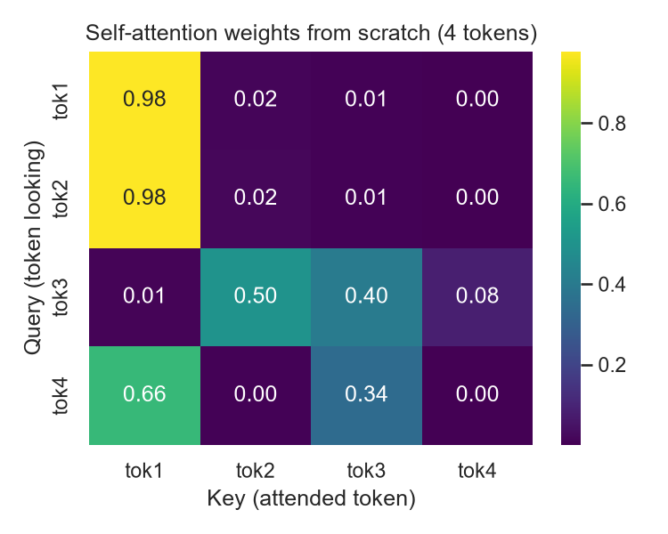<br/>**Attention from scratch** – 4×4 NumPy weights, every row sums to 1. | 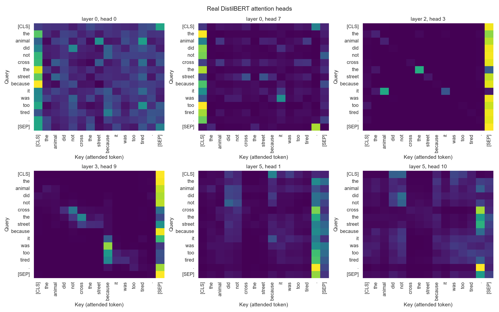<br/>**Real DistilBERT heads** – 6 heads from different layers with token labels. |
| 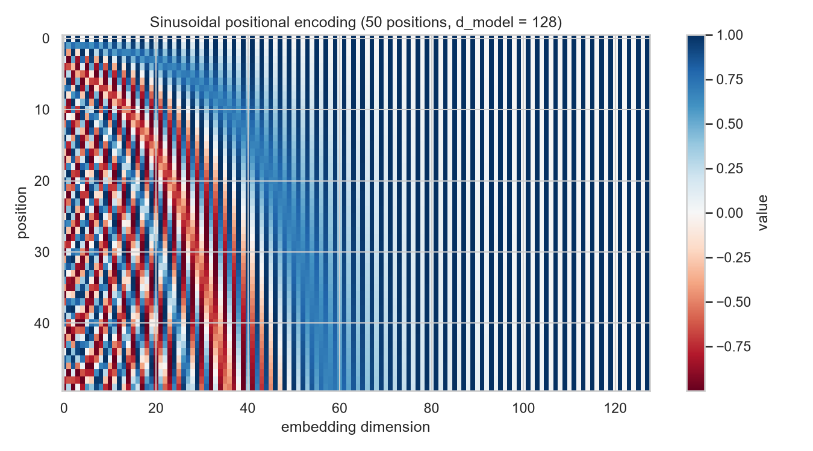<br/>**Sinusoidal positional encoding** – 50 positions × 128 dimensions. | 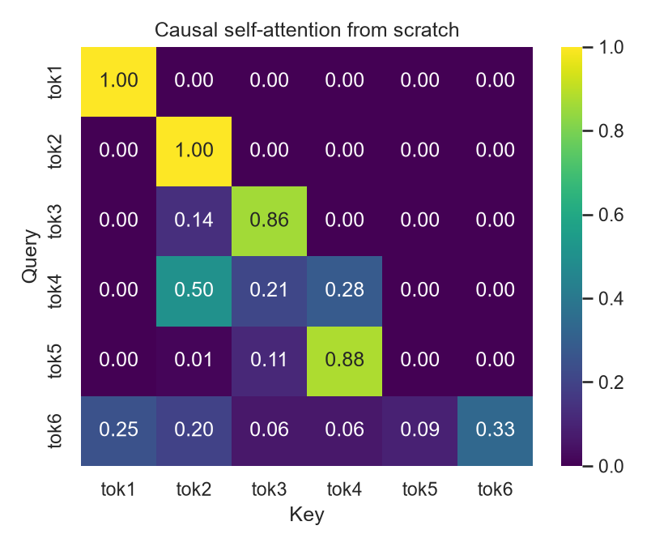<br/>**Causal self-attention** – lower-triangular weights built with a `-inf` mask. |
| 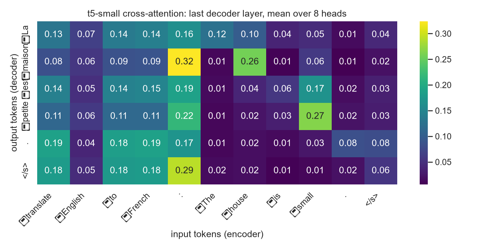<br/>**t5-small cross-attention** – output tokens (rows) vs input tokens (columns). | 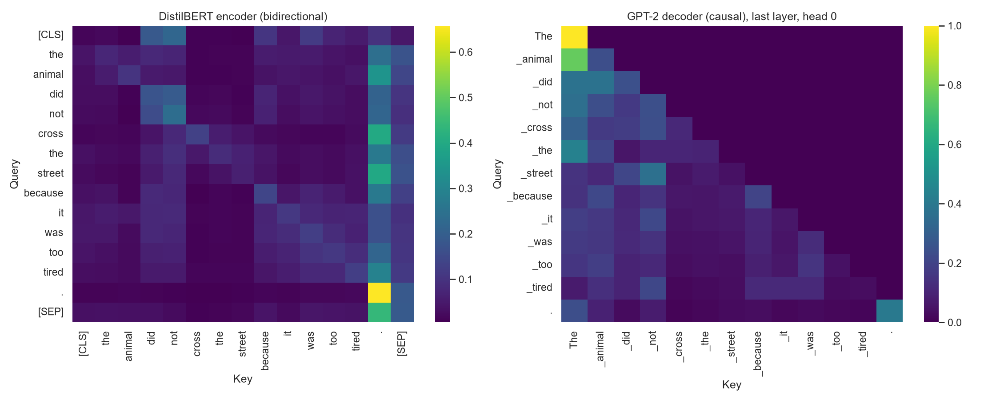<br/>**Encoder vs decoder** – bidirectional DistilBERT next to causal GPT-2. |
| 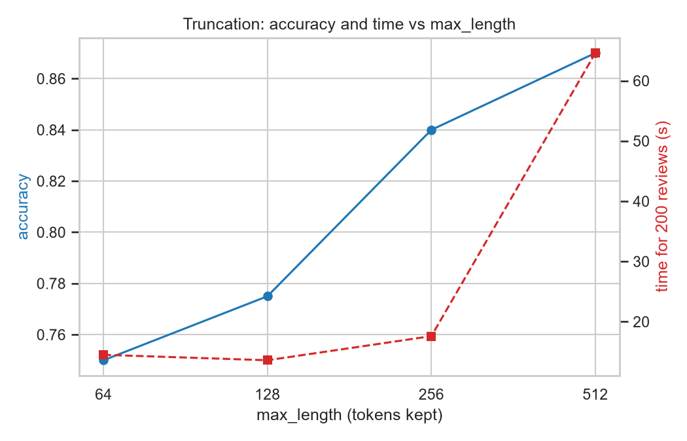<br/>**Truncation study** – accuracy and time against `max_length`. | 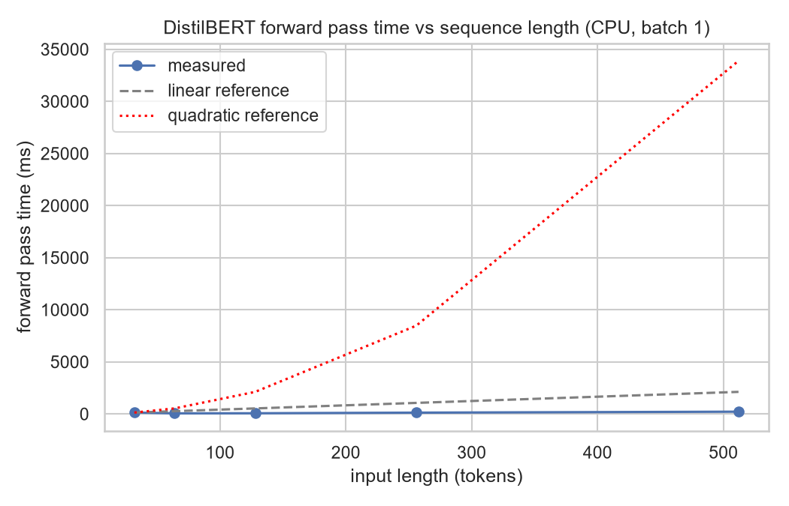<br/>**Cost vs length** – forward-pass time with linear and quadratic references. |

<details>
<summary><b>More plots</b></summary>

| | |
|---|---|
| 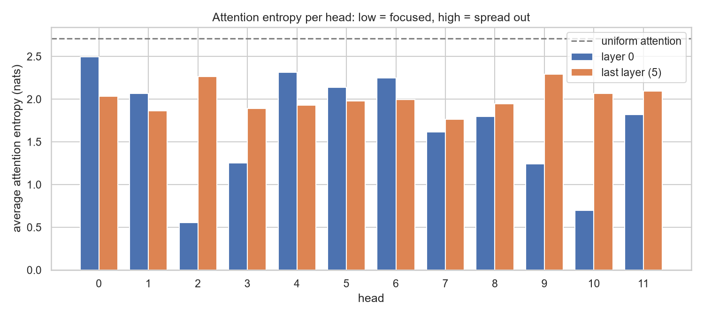<br/>Attention entropy per head (layer 0 vs last layer). | 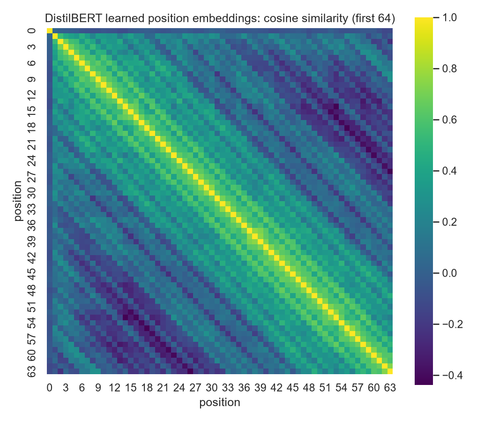<br/>Cosine similarity of DistilBERT's learned position vectors. |
| 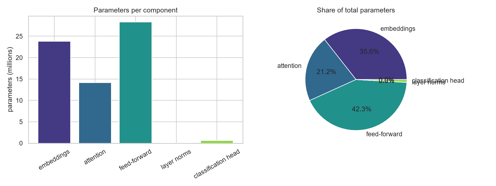<br/>Where the parameters live. | 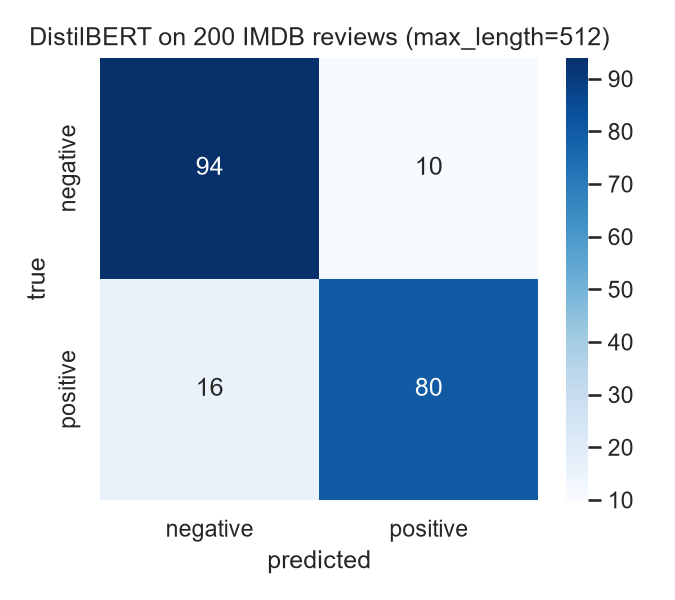<br/>Confusion matrix on 200 IMDB reviews. |

</details>

---

## 📊 Evaluation Results

> Fill in after running the notebook (the last cells of Task 6 print these numbers).

**Pretrained DistilBERT (SST-2) on 200 IMDB reviews, `max_length = 512`** — no training, domain transfer only.

| Metric | Value |
|---|---|
| Accuracy | _…_ |
| Precision | _…_ |
| Recall | _…_ |
| F1 | _…_ |

**Truncation study**

| max_length | Accuracy | Time (s) |
|---|---|---|
| 64 | _…_ | _…_ |
| 128 | _…_ | _…_ |
| 256 | _…_ | _…_ |
| 512 | _…_ | _…_ |

**Decoding / inference:** manual greedy loop identical to `generate()`: ✔ · KV-cache speed-up: _…×_

## ⚠️ Two Disadvantages I Measured
1. **Limited context window.** Reviews longer than 512 tokens lose text even at the maximum setting (_…_ of 200), and shorter windows cost accuracy (_… points_ between 64 and 512 tokens).
2. **Cost grows with sequence length.** The forward pass went from _… ms_ at 32 tokens to _… ms_ at 512 tokens. Attention is quadratic in theory; on a CPU with short inputs the curve looks closer to linear, and the notebook reports the measured log-log slope honestly.

A third one, **hallucination**, shows up in the GPT-2 facts check (three factual prompts graded correct / partly correct / wrong).

## 🛠️ Mini Application
`text_toolkit(text)` returns a sentiment label and score (DistilBERT), a short summary (t5-small, `max_length=60`) and its French translation. It is tested on a product review, a news paragraph and a passage of my own, and handles empty, non-text and very long inputs with a clear message.

## 🎥 Video
> Explanation video (face + screen, 5–10 min): **link coming soon**

[](#)

## 🧰 Tools
Python · PyTorch · Hugging Face `transformers` & `datasets` · NumPy · pandas · Matplotlib · Seaborn · scikit-learn · Jupyter
